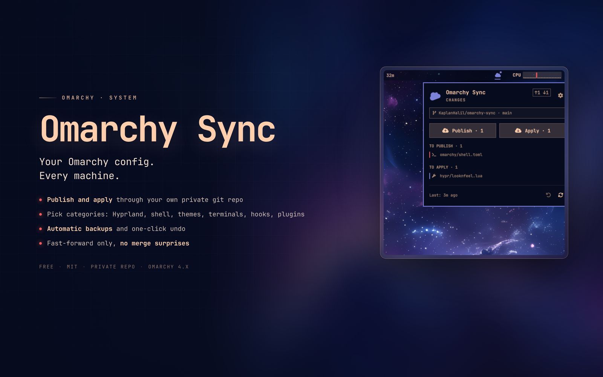

# Omarchy Sync

[](https://buymeacoffee.com/kaplanhalil)

Publish and apply your Omarchy configuration through your own **private** git
repository. One bar icon, one compact panel: choose what syncs, publish from
one machine, apply on another, and undo an apply with one click.



Omarchy Sync is a minimal replacement for heavyweight dotfile synchronisers.
It mirrors a small, explicit whitelist of `~/.config` files, keeps machine-local
settings out of the repo, and never tries to merge two machines line by line.
If the histories diverge, Apply stops and tells you the exact git command to
run.

## Features

- **Publish / Apply / Undo** from the bar. No terminal needed after setup.
- **Category filters.** Hyprland, shell, themes, terminals, hooks,
  extensions, branding, agents and the plugin list can each be switched on or
  off per machine.
- **Machine-local settings.** What a machine publishes or applies is stored
  locally, so a laptop can skip display layout while a desktop syncs it.
- **Automatic backups.** Every Apply writes a timestamped backup first; Undo
  restores it.
- **Fast-forward only.** No silent merges. Divergence is reported with the
  command to resolve it.
- **Plugin list sync.** Git-installed plugins travel as URLs, not as copied
  files. Missing ones are installed on Apply when the Plugins category is on.
- **Theme-aware UI.** The panel follows the active Omarchy theme, font and
  corner radius.
- **Quiet by default.** No daemon, no telemetry, no outbound traffic except
  `git fetch` / `git push` to the repository you configure.

## Requirements

- Omarchy Quattro (4.x) with the Quickshell shell.
- `python3` and `git` — both present on a normal Omarchy install.
- A **private** empty git repository you control (GitHub, GitLab, or a local
  bare repository). The configuration it stores can contain API keys, SSH
  hosts and personal shortcuts.

No extra packages, no root, no background service.

## Install

```bash
omarchy plugin add https://github.com/KaplanHalil/omarchy-sync-plugin.git --enable
```

If the widget was not placed automatically:

```bash
omarchy plugin enable io.github.kaplanhalil.sync --section right
```

You can also drag it in the bar, or move it later with:

```bash
omarchy bar move io.github.kaplanhalil.sync --section right
```

## Setup

1. Create an **empty private** repository, for example
   `github.com/<you>/omarchy-config` (do not initialise it with a README).
2. Click the cloud icon in the bar, paste the URL, press **Connect**.
3. On the first machine press **Publish**. This writes the current config into
   the repo and pushes it.
4. On the next machine install the plugin, Connect the same URL, then
   press **Apply**. The first Apply backs up anything it overwrites.
5. Open the gear and switch off the categories this machine should not
   publish or apply (for example **Display layout**).

> Apply overwrites the covered files under `~/.config`. The backup is the
> safety net; the panel asks for a second click before applying.

## Use

- **Bar icon** — a cloud with a status dot: accent for remote changes, urgent
  for local changes or errors. It rotates while an operation runs.
- **Left click** — open the panel. **Right click** — refresh the remote state.
- **Publish** — copy this machine's config into the repo, commit, push.
- **Apply** — fetch, fast-forward, back up, copy the repo back, reload
  Hyprland / re-apply the theme when needed.
- **Undo** — restore the newest Apply backup.
- **Gear** — category filters, auto-fetch interval, Buy Me a Coffee.
- **Esc** — close the panel.

The footer shows the relative last-sync time and how many backups are available.

## Settings

Open the gear in the panel. Everything is machine-local and stored in
`~/.local/share/omarchy-sync/settings.json`.

| Category | Covers | Default |
|---|---|---|
| Hyprland | `hypr/*.lua`, `*.conf` (except monitors) | on |
| Display layout | `hypr/monitors.lua` | off (machine-specific) |
| Shell | `omarchy/shell.json`, `shell.toml` | on |
| Themes | theme selection + `omarchy/themes/**` overlays | on |
| Terminals | alacritty, foot, ghostty, kitty | on |
| Hooks | `omarchy/hooks/**` | on |
| Extensions | `omarchy/extensions/**` | on |
| Branding | `omarchy/branding/**` | on |
| Agents | `omarchy/agents/**` | on |
| Plugins | `plugins.json` (git URLs) | on |

**Auto-fetch** checks the remote every 30 minutes, 1, 3 or 6 hours, or not at
all. The panel always refreshes when opened.

A switched-off category is ignored in **both directions**: it is not published,
not applied, and not listed. Files already in the repo for that category are
left untouched, so turning a category off never deletes data. Each machine
therefore applies its own subset of the shared repo.

## Repository layout

```
<repo>/
├── .omarchy-sync.json        marker: {"format":"omarchy-sync","version":1}
├── config/                   → ~/.config/
│   ├── hypr/*.lua|*.conf
│   ├── omarchy/shell.json, shell.toml, theme.name
│   ├── omarchy/themes/<slug>/
│   ├── omarchy/{hooks,extensions,branding,agents}/
│   └── alacritty/ foot/ ghostty/ kitty/
└── plugins.json              git-installed plugins: {"id":"git-url"}
```

Excluded on purpose: `hypr/monitors.lua` (unless enabled), `*.bak*`, `.git`,
`~/.config/omarchy/plugins/`, and theme wallpapers/previews. `~/.local/bin` is
not synced in this version.

## How it works

`sync.py` is a small stdlib-only backend. It prints one JSON object per command
and the QML panel only renders state and calls actions:

```bash
python3 sync.py status [--fetch]
python3 sync.py link <url|owner/repo|path>
python3 sync.py publish
python3 sync.py apply
python3 sync.py undo
python3 sync.py settings
python3 sync.py settings hypr false
python3 sync.py settings refresh 60
```

State lives in `~/.local/share/omarchy-sync/` (settings and the repo clone) and
`~/.local/state/omarchy-sync/backups/` (Apply backups). Nothing outside the
whitelist is written without an explicit Apply.

**Security:** the plugin runs as unsandboxed QML/Python code, like every
Omarchy plugin. It never uses `sudo`, never downloads and executes remote
scripts, and only talks to the git remote you configure. Keep the config
repository private: it contains your shell, Hyprland and terminal configs.

## Remove

```bash
omarchy plugin remove io.github.kaplanhalil.sync
```

Optionally remove the local state and backups:

```bash
rm -rf ~/.local/share/omarchy-sync ~/.local/state/omarchy-sync
```

Your configuration repository is not touched.

## Development

```bash
PLUGIN_DIR="$HOME/.config/omarchy/plugins/io.github.kaplanhalil.sync"
omarchy plugin validate "$PLUGIN_DIR"
omarchy-shell shell rescanPlugins
```

`qmllint` needs a small module root that mirrors the shell's `qs.*` mapping:

```bash
LINT_ROOT="${XDG_RUNTIME_DIR:-/tmp}/sync-qml"
mkdir -p "$LINT_ROOT/qs"
ln -sfn "$OMARCHY_PATH/shell/Commons" "$LINT_ROOT/qs/Commons"
ln -sfn "$OMARCHY_PATH/shell/Ui" "$LINT_ROOT/qs/Ui"
qmllint -I "$LINT_ROOT" "$PLUGIN_DIR"/*.qml
```

Test the backend without touching the real configuration:

```bash
export OMARCHY_SYNC_HOME=/tmp/sync-home
export OMARCHY_SYNC_NO_RELOAD=1 OMARCHY_SYNC_NO_INSTALL=1
python3 sync.py link /tmp/sync-remote.git
python3 sync.py status --fetch
python3 sync.py publish
```

Regenerate the marketplace preview from a live capture with the panel open:

```bash
preview/build.sh /tmp/capture.png
```

## Support

If Omarchy Sync is useful to you, you can buy me a coffee:

[Buy Me a Coffee](https://buymeacoffee.com/kaplanhalil)

The same link is in the panel settings.

## License

MIT. See [LICENSE](LICENSE).
